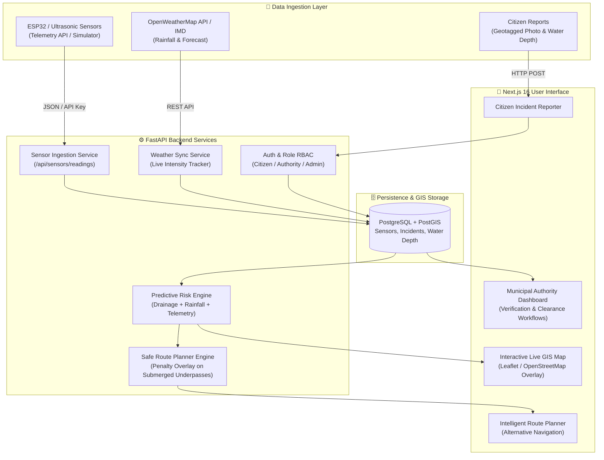
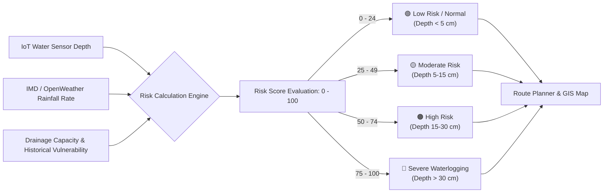
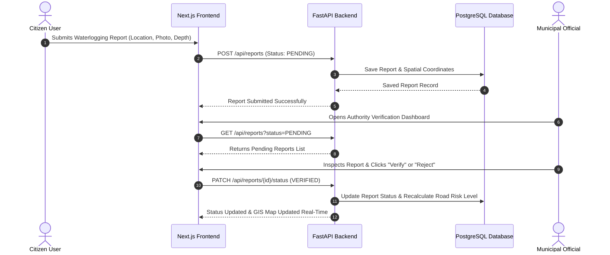

# Nagpur WaterWatch 🌊🚗

**Real-Time and Predictive Waterlogging Monitoring and Intelligent Route Recommendation System for Nagpur**

---

## 📌 Project Overview

**Nagpur WaterWatch** is an integrated smart-city platform designed to combat urban pluvial flooding and waterlogging across vulnerable road segments in Nagpur. The system combines real-time IoT water-level sensor telemetry, meteorological rainfall data, historical incident patterns, geotagged citizen feedback, and route risk analysis to recommend safer travel routes.

### Key Capabilities

1. **Live GIS Monitoring Dashboard:** Displays current waterlogging severity levels (*Green: Normal, Yellow: Caution, Orange: Moderate, Red: Severe*) across Nagpur road segments.
2. **IoT Sensor Telemetry API & Simulator:** Ingests water depth measurements from ESP32/Arduino ultrasonic sensors (`/api/sensors/readings`). Includes a CLI simulator with multiple rainfall scenarios.
3. **Weather Service Integration:** Tracks current rainfall, intensity, and 1-hour forecasts (supports OpenWeatherMap API & simulated fallback, with clear data provenance labels).
4. **Predictive Risk Engine:** Rule-based explainable risk engine combining rainfall intensity, historical frequency, drainage capacity, and current water levels.
5. **Intelligent Safe Route Planner:** Overlays verified and predicted waterlogging data onto Google Maps routing results, recommending safer alternative routes that avoid submerged underpasses.
6. **Citizen Reporting & Verification:** Allows citizens to submit geotagged road condition reports, which are cross-referenced and verified by municipal authorities before updating official severity maps.
7. **Authority Hotspot Analytics:** Provides authorities with hotspot rankings, clearance-time tracking, incident resolution workflows, and root cause analysis.

---

## 📊 System Architecture & Data Flow Charts

### System Architecture Overview



### Risk Prediction Pipeline



### Citizen Incident Verification Flow



---

## 👥 Project Team & Credits

- **Harshita Agrawal** (Roll No. 32)
- **Reeti Khandelwal** (Roll No. 20)
- **Richa Chandak** (Roll No. 37)
- **Ananya Biyani** (Roll No. 27)

**Guided by:** Dr. Avinash Agrawal  
**Programme:** Computer Science & Engineering  
**Semester:** Vth (Session 2026–27)

---

## 🛠️ Technology Stack

- **Frontend:** Next.js 16 (App Router), TypeScript, Tailwind CSS, Recharts, Lucide Icons
- **Backend:** FastAPI (Python 3.11+), SQLAlchemy 2.0, Pydantic v2, PyJWT, Passlib (Bcrypt)
- **Database:** PostgreSQL 15 with PostGIS extension (Docker containerized)
- **ML / Analytics:** Python, Pandas, NumPy, Scikit-learn, GeoPandas
- **IoT & Telemetry:** ESP32/Arduino REST API ingestion (`X-Sensor-Key` authenticated)

---

## 🔑 Demo Credentials

| Role | Username | Password | Access Level |
| :--- | :--- | :--- | :--- |
| **Citizen** | `citizen` | `citizen123` | Submit reports, view live map, plan routes |
| **Authority** | `authority` | `authority123` | Verify citizen reports, view hotspot analytics |
| **Admin** | `admin` | `admin123` | Full system configuration, sensor & user management |

---

## 🚀 Local Setup Instructions

### 1. Database Setup (Docker PostGIS)

```bash
# Start PostgreSQL PostGIS container
docker-compose up -d
```

### 2. Backend Setup (FastAPI)

```bash
cd backend

# Create & activate virtual environment
python -m venv venv
# On Windows:
.\venv\Scripts\activate
# On Linux/macOS:
source venv/bin/activate

# Install dependencies
pip install -r requirements.txt

# Seed database with sample Nagpur data & demo credentials
python -m app.seed.seed_data

# Start FastAPI development server
uvicorn app.main:app --reload --port 8000
```

FastAPI Interactive API Documentation: `http://localhost:8000/docs`

### 3. Sensor Simulator (Demo Hardware Telemetry)

In a separate terminal window, launch the IoT sensor simulator to generate dynamic water levels:

```bash
cd backend
python -m app.simulator.sensor_sim --scenario heavy_rain --interval 10
```

*Available Scenarios:* `dry`, `light_rain`, `moderate_rain`, `heavy_rain`, `extreme`, `clearing`.

### 4. Frontend Setup (Next.js)

```bash
cd frontend

# Install dependencies
npm install

# Build & launch development server
npm run dev
```

Open `http://localhost:3000` in your web browser.

---

## 🛰️ Integration & Data Provenance Disclosure

| Component | Status / Integration Source | UI Provenance Label |
| :--- | :--- | :--- |
| **IoT Sensor Telemetry** | Functional FastAPI ingestion endpoint; default data generated via CLI Simulator | `DEMO / SIMULATED DATA` |
| **Rainfall & Weather** | OpenWeatherMap API integrated; falls back to monsoon simulation if key is absent | `OpenWeatherMap` or `SIMULATED` |
| **Map & Safe Routing** | Custom spatial overlays on Google Maps coordinates | `Overlay Data (Nagpur WaterWatch)` |
| **Predictive Risk** | Explainable rule-based risk scoring engine | `rule-based-v1 (Baseline)` |

---

## 📜 License

Developed for presentation and demonstration, 2026–27.
